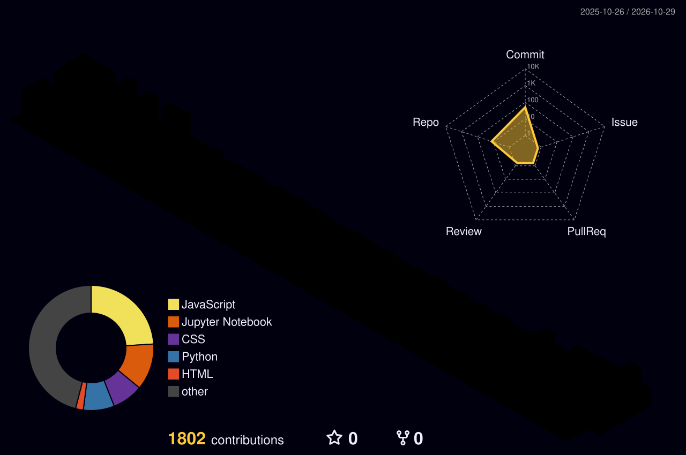

<!-- ============================ HEADER ============================ -->
<div align="center">


<a href="https://git.io/typing-svg">
  
</a>

<br/>


<br/>

<a href="mailto:syedfarhanfawad007@gmail.com"></a>
<a href="https://www.linkedin.com/in/syed-farhan-fawad/"></a>
<a href="https://github.com/farhanfawad007"></a>
<a href="#-contact"></a>

</div>


<!-- ============================ ABOUT ============================ -->
## 👨‍💻 About Me

<table>
<tr>
<td width="60%" valign="top">

```js
const farhan = {
  name: "Syed Farhan Fawad",
  role: "Software Engineer | Full-Stack • AI • Cloud",
  location: "Bengaluru, India 🇮🇳",
  education: "B.E. Computer Science @ Atria Institute of Technology (2024–2028)",
  leading: "Technical Department @ OSCode Atria Chapter",
  currentlyLearning: ["AWS Cloud", "DSA", "Advanced React", "AI/ML"],
  funFact: "I build web apps, dashboards AND IoT gadgets ⚡",
  lookingFor: "Internships • Open-source • Technical collabs"
};
```

</td>
<td width="40%" valign="top">

### ⚡ Quick Snapshot
🎓 **6** internships completed<br/>
🏆 **9.29 / 10** project evaluation score<br/>
💰 **7+** sponsorships secured (+60% funding)<br/>
🎤 **3+** events organized<br/>
🧰 **20+** technologies used<br/>
🌐 Full-Stack · Data · IoT · Cloud

</td>
</tr>
</table>

<!-- ============================ TECH STACK ============================ -->
## 🛠️ Tech Stack

<div align="center">

**Languages**<br/>
<br/><br/>
**Frontend**<br/>
<br/><br/>
**Backend & Databases**<br/>
<br/><br/>
**Data & Analytics**<br/>


<br/><br/>
**Cloud & Tools**<br/>
<br/><br/>
**IoT & Embedded**<br/>


</div>


<!-- ============================ PROJECTS ============================ -->
## 🚀 Featured Projects

<table>
<tr>
<td width="50%" valign="top">

### 🔁 [Skill Trader](https://github.com/farhanfawad007/skill-trader)
> *Swap skills, not money.*

A skill-exchange platform with **match-percentage** and **availability-based matching**, swap request lifecycle, ratings & feedback, and **gamification badges**. Dark/light responsive UI with offline persistence.

🏅 **Evaluation score: 9.29 / 10**


</td>
<td width="50%" valign="top">

### 🛒 [E-Commerce Web App](https://github.com/farhanfawad007/YOUR_ECOMMERCE_REPO)
> *End-to-end shopping experience.*

Responsive storefront with **RESTful APIs**, secure authentication, third-party API integration, **Jest unit tests**, optimized load times, and AWS (EC2, S3) deployment.

⚙️ **Full-stack · Tested · Cloud-exposed**


</td>
</tr>
<tr>
<td width="50%" valign="top">

### 📊 [Data Analytics Dashboards](https://github.com/farhanfawad007/YOUR_DATA_REPO)
> *From messy data to clear decisions.*

Python/Pandas cleaning pipelines, an **Excel sales dashboard** (Pivot Tables), and cross-filtering **Power BI & Tableau** dashboards on **HR attrition** and the **Global Happiness Index**.


</td>
<td width="50%" valign="top">

### 🔌 [IoT Projects](https://github.com/farhanfawad007/YOUR_IOT_REPO)
> *Where software meets hardware.*

Arduino & ESP8266/ESP32 builds featuring **sensor integration**, **firmware programming**, and **device communication**.


</td>
</tr>
</table>

<!-- ============================ EXPERIENCE ============================ -->
## 💼 Experience Timeline

```text
2024 ─────────── 2025 ─────────── 2026 ───────────▶
 │                 │                │
 ▼                 ▼                ▼
SkillCave        Krutanic        Rotaract/Atria  →  SkillCraft
(Aug–Nov 24)     (Sep–Dec 25)    (Nov 25–Jan 26)     (Jun 26)
```

<details open>
<summary><b>📊 Data Analyst Intern — SkillCraft Technology</b> &nbsp;<code>Jun 2026</code></summary>
<br/>

- Built end-to-end **Python/Pandas pipelines** (Jupyter/Colab): handled missing values, duplicates, and type casting for high data integrity
- Designed a **Sales Performance Dashboard** in Excel with Pivot Tables and advanced Conditional Formatting (sales, category profit, trends)
- Created interactive **Power BI & Tableau** dashboards on HR employee attrition and the Global Happiness Index
- Enabled stakeholders to drill down by region, age group, and department to find root causes of turnover

</details>

<details>
<summary><b>🌐 Full Stack Web Developer Intern — Rotaract Club of Atria Institute of Technology</b> &nbsp;<code>Nov 2025 – Jan 2026</code></summary>
<br/>

- Co-built **Skill Trader**, a skill-swap platform (evaluation score **9.29/10**)
- Developed responsive pages with HTML5, CSS3, JavaScript and DOM manipulation
- Implemented authentication, profile management, skill matching, and swap request lifecycle
- Added match-percentage logic, ratings & feedback, gamification badges, and dark/light mode
- Collaborated through Git/GitHub on dashboards, categorization, and tracking modules

</details>

<details>
<summary><b>⚛️ Full Stack Engineer Intern — Krutanic (Accenture Alliance Program)</b> &nbsp;<code>Sep 2025 – Dec 2025</code></summary>
<br/>

- Built responsive apps with HTML5, CSS3, Bootstrap, and JavaScript (ES6+) with API integration
- Created dynamic **React.js** components (JSX, Props, State, Hooks) with Flexbox, Grid, and Media Queries
- Performed CRUD operations with **MongoDB** and connected front-end to backend workflows

</details>

<details>
<summary><b>🛍️ Full Stack Engineer Intern — SkillCave</b> &nbsp;<code>Aug 2024 – Nov 2024</code></summary>
<br/>

- Built a responsive e-commerce app end-to-end with HTML, CSS, Bootstrap, and JavaScript (AJAX)
- Developed **REST APIs** with Node.js, Express.js, and MongoDB/Mongoose
- Implemented secure authentication and third-party API integrations
- Wrote **Jest** unit tests, optimized load times, and gained **AWS (EC2, S3)** deployment exposure

</details>

<!-- ============================ LEADERSHIP ============================ -->
## 🏆 Leadership & Community

| 🎖️ Role | 🏛️ Organization | 📅 Period | ✨ Impact |
|:--|:--|:--|:--|
| **Technical Development Lead** | OSCode Atria Chapter | Mar 2026 – Present | Leads the technical department, mentors members, runs technical activities |
| **Member, Technical** | RevX Atria (Formula Bharat) | Apr 2025 – Present | 7+ sponsorships, **+60% funding**, 3+ events organized |
| **PR Coordinator** | AWS Student Builder Group, Atria | Mar 2026 – Present | Promotes cloud/AWS workshops and technical events |
| **Member, Technical** | Atria Code Committee | Nov 2025 – Present | Collaborative software projects and debugging |
| **Member, Technical** | IoT Forge Club | Dec 2025 – May 2026 | Arduino/ESP sensor and firmware projects |


<!-- ============================ STATS ============================ -->
## 📊 GitHub Analytics

<div align="center">


</div>

### 🎮 Pac-Man 

<picture>
  <source media="(prefers-color-scheme: dark)" srcset="https://raw.githubusercontent.com/farhanfawad007/farhanfawad007/output/pacman-contribution-graph-dark.svg">
  <source media="(prefers-color-scheme: light)" srcset="https://raw.githubusercontent.com/farhanfawad007/farhanfawad007/output/pacman-contribution-graph.svg">
  
</picture>

### 🌆 3D Contribution Skyline

<div align="center">

</div>

<!-- ============================ CONTACT ============================ -->
## 🤝 Contact

<div align="center">

*I love connecting with developers, exchanging ideas, and collaborating on useful software projects.*

<a href="mailto:syedfarhanfawad007@gmail.com"></a>
<a href="https://www.linkedin.com/in/syed-farhan-fawad/"></a>
<a href="https://github.com/farhanfawad007"></a>

<br/><br/>

⭐ *If you like what you see, drop a star on my repos!* ⭐


</div>
